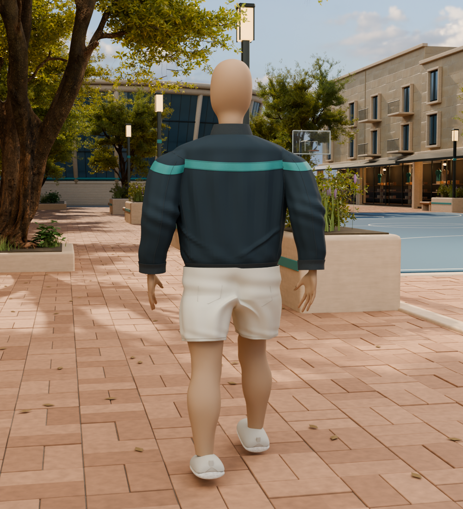
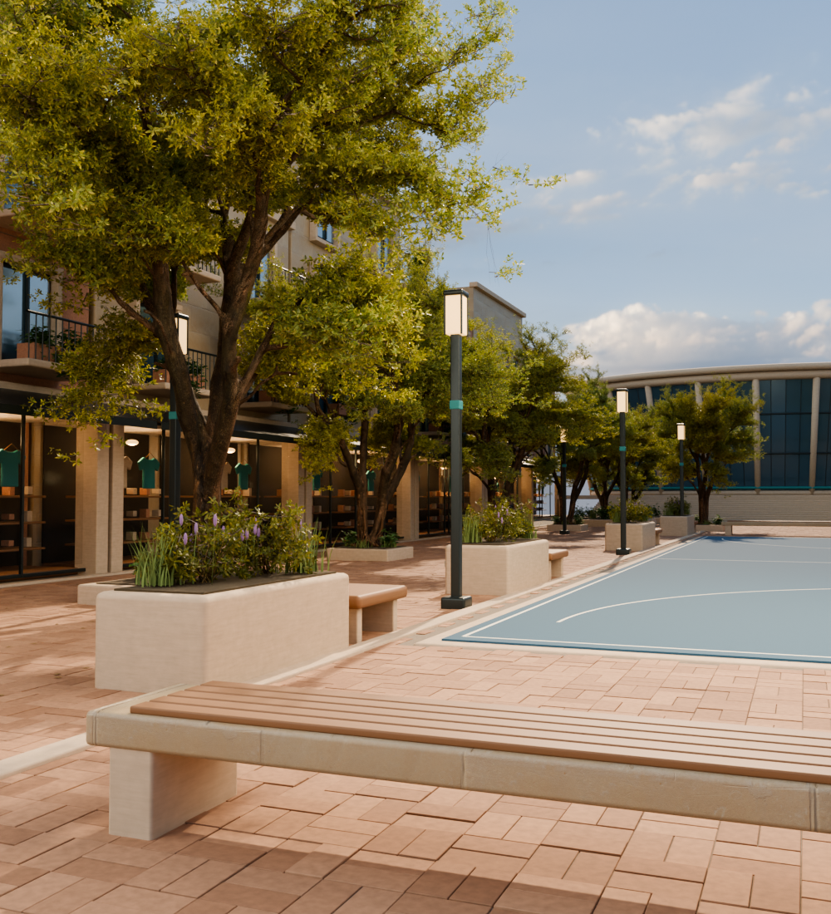

# Sundale character and landscape study

September 25 full-front review: `LegAxisCandidate/Leg_Axis_Full_Front.png` and `Leg_Axis_Knee_Close.png` reveal the remaining stiff torso/shorts and smooth knee contours. Pose-derived pelvic support, support-guided shorts expansion and two local knee sculpts failed visual review and remain ignored studies. `LegAxisCandidate/LegAxis.blend` is still the clean editable source; see [UpperShortsRebuild.md](UpperShortsRebuild.md) for the garment diagnosis. The very-real human goal remains active.

Latest September 25 checkpoint: `LegAxisCandidate/LegAxis.blend` aligns the right shorts opening more closely to the visible walking thigh and moves its sewn hem details with it. Saved-scene front/rear/profile/full-body/gameplay renders and cold/hem-contact checks are retained. This is a lower-leg fit gain, not completion of the very-real human goal; the upper shorts, face/skin, jacket and footwear still need work.

September 24 fit study: a source-derived pelvis intersects much of the current upper shorts, and both a native cloth settle and filtered variants produce visible crotch/hem defects. Those trial scenes were rejected after front/rear render review; `GussetWidthCandidate/GussetWidth.blend` remains the latest clean editable checkpoint. [UpperShortsRebuild.md](UpperShortsRebuild.md) records the measurements and the coupled panel/support rebuild needed next. The very-real human goal is still active.

Latest September 24 gusset checkpoint: `GussetWidthCandidate/GussetWidth.blend` widens the shorts' **existing** paired gusset and blends it through the upper legs. A corrected audit measures 21.5 mm maximum span before and 47.3 mm after; the historical 44 mm property was a nominal design value. Front/rear close renders improve modestly, while full-body and gameplay differences are small. The broad upper shorts panels and overall human realism remain unfinished.

Latest September 24 fit checkpoint: `PanelBalanceCandidate/PanelBalance.blend` uses a measured front/rear arc audit to redistribute lower-hip shorts depth, with a held waistband and refitted back pockets. Matched native front, rear, profile, and full-figure views show a modest improvement without a new band gap. The existing annular shorts shell and saddle still need an actual panel reconstruction before the very-real human goal can be accepted.

September 24 continuation: `CrewCutCandidate/CrewCut.blend` retains a more directional graduated short crop on the same verified scalp roots. Matched front, three-quarter and full-rear renders show a modest head improvement. A skin/iris material trial was too subtle and a larger seat-volume trial looked padded, so neither became the new source. The very-real human goal remains open: reconstruct the upper shorts/saddle and continue face, jacket and footwear work before assessing the full scene against the original concept.

**Anatomical shorts fit checkpoint:** A restrained outer-leg taper now follows the posed thigh with explicit cloth clearance. The overall human-realism goal remains open; see [VisualReview.md](VisualReview.md).

**Cropped scalp and sole checkpoint:** Native scalp fibers, molded shoe edges and a reinforced canvas heel extend the editable character. The human-realism goal remains unfinished; see [VisualReview.md](VisualReview.md).

**Open shell jacket checkpoint:** The character now has a real open, thin jacket shell, reproducible anatomical drape, fitted outer seams and finer stitched footwear. The visual-realism goal remains unfinished. See [VisualReview.md](VisualReview.md) and [DevelopmentGoal.md](DevelopmentGoal.md).

Continuing from `0215059`, the brows now use a wider, tapered distribution of individually fitted strands with varied length, lean, lift and brown tones. A separate editable resting-eyelid control gives a small asymmetric upper-lid lift. Eyelashes and lower wet margins are regenerated against the changed facial surface. The retained anatomical facial controls, skin texture and fitted neck remain intact.

The human-realism goal remains active. Brow/eyelid presentation is improved, but the figure still needs whole-body visual refinement, especially broad garment fold transitions and overly simple footwear surfaces. Next address those larger remaining body cues and reassess the complete character against the original concept, including face/skin quality. Architecture/retail variety and planting follow human acceptance. This is editable offline Blender art, with no runtime or animation-rig claim.

Continuing from `63cfd9a`, the retained skin texture now has a separate fine pore-relief layer. Hand-specific fields follow the original anatomical joints for crease relief and restrained color variation. A small editable vascular shape control adds back-of-hand definition with matching subdued pigment. Ten closed nail-fold surfaces follow the actual skin beside the proximal nail edges and inherit the original skin UVs. Face and hand scattering/specular response have been adjusted in the native materials.

The full human-realism goal remains active. Fine hand and skin cues are improved, but facial expression, sparse brows and broad cloth folds still make the figure look synthetic. Next develop more natural brow/eyelid presentation and facial expression, then continue garment surface refinement and whole-figure review. Architecture/retail variety and planting remain after human acceptance. Preserve the editable native source and original licenses; this checkpoint changes offline art, not a runtime character or animation rig.

Continuing from `f73e021`, the jacket now settles against a hidden, editable torso and arm surface derived from the retained CC0 anatomy and male body target. The support follows the posed shoulders, elbows and wrists. The cloth uses zero added expansion, a smoother collision surface and firmer waistband attachment. Original tailoring, the fitted starting surface and raw gravity output are retained separately; displacement filtering now preserves fully pinned trim. Pockets, raglan seams, teal panels and fastening follow the final cloth.

The human-realism goal remains active. The jacket has a slimmer, more body-supported silhouette, but fold transitions and material response still need refinement; skin and cuticles remain too uniform. Next improve these visible surface qualities and review the full character against the original reference. Architecture/retail variety and planting realism follow human acceptance. The internal torso is a cloth-fitting aid; this is an editable offline Blender study, not a visible replacement body, production animation rig or runtime update.

Continuing from `e6d5412`, the head now retains original source-vertex identities and four editable facial shape controls: three additional pinned CC0 anatomical targets plus restrained authored asymmetry. The adult macro target is anchored at the source head joint to remove its whole-body height shift. A wider rear-neck blend preserves the collar fit. Eye surfaces follow the source eye-joint changes, brow strands follow the deformed facial surface, and wet eyelid margins are refitted. A facial roughness field gives the nose/forehead a different response from the cheeks, with increased subsurface contribution over the retained color map.

The full human-realism goal remains active. Skin still lacks convincing fine variation, and garment folds remain soft. Next improve torso/sleeve tension and jacket drape with anatomical body support, continue skin/cuticle refinement, and review the complete figure against the original concept. Architecture/retail variety and planting realism follow human acceptance. This remains editable offline Blender art, not a runtime character or animation-rig update.

Continuing from `0fb8d78`, both hands retain unposed anatomical coordinates and joint landmarks. A separate editable shape key adds restrained knuckle, extensor-tendon and palm-crease relief while preserving the posed base surface. Ten curved nail plates are fitted through the source-to-posed surface correspondence, with fine thickness, keratin shading and a subtle free-edge tint. Permanent left/right hand inspection cameras expand the native review set to ten views.

The full realism goal remains active. The hands have more definition but still need finer skin/cuticle quality; the face remains generic, and the jacket folds remain too soft in places. Next develop facial individuality and broader skin variation, then reassess the whole character and garment folds against the original reference. Architecture/retail variety and planting realism follow human acceptance. This remains an editable offline Blender study, with static fitted nails rather than an animation rig or runtime update.

Continuing from `3786385`, the eyes now have a continuous closed surface with transparent corneal zones over recessed iris bowls and pupil surfaces. Native comparisons led to smaller pupils and brighter iris pigment after the first refractive study looked too dark. Two fine lower eyelid margins follow the visible skin/eye boundary. Skin relief is finer and its subsurface scale is reduced over the unchanged source color map.

The full human-realism goal remains active. The face still feels generic and the skin too uniform; the existing hand close-ups still show soft knuckles and insufficient tendon/nail detail. Next develop hand surface anatomy and facial individuality, continue judging garment fold quality, and review the whole figure against the original concept. Architectural/retail variety and planting realism follow human acceptance. This is an editable native Blender study, not a runtime update or final-art approval.

Continuing from `f406b8e`, the jacket now uses a 45-frame native gravity study on a lighter control mesh, with 4% fabric ease and fixed collar, fastening, hem and cuff attachments. A smooth inner fitting envelope supports the cloth; this is a garment proxy, not newly scanned body anatomy. The retained result blends 85% filtered simulation displacement with the tailored base. Original tailoring and raw simulation positions remain editable point attributes.

The first dense, low-bending-resistance study produced a crumpled leather-like surface and was rejected. A coarser, stiffer study reduced the small wrinkles; strong filtering then made it too rigid. The retained version adds fabric ease and uses six displacement-filter passes to keep broader folds. Native front/rear comparisons also led to a darker slate dye, a more matte fabric response and fitted front/back raglan seams. Stray shoulder lines were traced to old torso-profile yoke stitch ends. All three teal panels now receive stitches from their actual boundary edges. Further close-ups led to nearly flush, subdivided teal panels, removal of the old overlapping sleeve/panel lines, and continuous raglan paths over connected garment faces that meet beneath each arm. The seam search permits face diagonals to avoid the stair-step paths of a rectangular edge grid. A later clearance review caught zipper tape buried by the drape; tape and teeth are fitted to the final jacket/collar front surface, and the saved-scene check now verifies positive tape clearance.

The human-realism goal remains active. This improves the jacket development baseline, but the figure still reads as a digital model. Garment fold sharpness and tailoring, hand tendon/nail detail, skin response, eye tissue and individual facial expression remain unfinished. Continue close-up and whole-figure review against the original reference, then architectural/retail variety and planting realism. The scene is an editable static Blender study; no runtime cloth, animation rig, game-character update or beta-exit credit is claimed.

Continuing from `3b3caa0`, the forearms hang closer beneath the elbows and a shaped collar follows the neck, with a smaller continuous zipper and pull. Three pinned CC0 MakeHuman morph targets add restrained facial-age and eyelid changes in memory; the original anatomical OBJ remains unchanged. Native irises now carry radial color variation, finer brows follow a changing hair direction, and 96 tapered eyelashes are rooted at the actual visible lid margins. These details remain subtle and do not establish a lifelike facial expression.

The footwear now has recessed ankle openings with dark inner lining, a denser fitted tongue, crossed laces seated at paired eyelets, bow loops and free ends. The upper and sole profiles use smooth longitudinal interpolation; rounded sole edges surround a broad flat underside. Native close-ups exposed tongue intersections, displaced lace endpoints and an uneven upper/sole join. Those findings led to denser tongue faces, matching endpoint projections and a deeper upper overlap inside the extended sole.

The full realism goal remains active. The next major character work is shoulder/armhole construction and jacket drape, followed by hand tendon/nail detail, convincing eye tissue, skin response and expression. Review the complete figure against the original concept before proceeding to architectural/retail variety and planting realism. This checkpoint is an editable offline model, not an animation rig, gameplay cloth implementation or runtime update.

The owner’s first OddsWell concept picture remains the visual target. [DevelopmentGoal.md](DevelopmentGoal.md) records the active goal and acceptance criteria. The scene is being developed through actual modeling and Blender Cycles renders; the reference is not projected onto geometry or used as a scene background.

September 21 continuation: after the modest fold checkpoint `8c868ec`, the shorts were rebuilt as a continuous tailored surface through the hips and inseam, the sleeve caps and shoulder join were softened, and civic limestone gained restrained sediment variation. All six native views were rebuilt. The visual goal remains active; see [VisualReview.md](VisualReview.md) for the remaining gaps.

The owner's next direction was to make the character more human. From checkpoint `c255dd5`, the featureless oval head was replaced with the retained anatomical skull, jaw, nose, lips and ears. Fitted eyes, fine brow strands and localized skin tint complete this first human-face study. A cropped source-shoulder defect was caught in close-up and removed; the neck now extends inside the collar. The review set includes eight native views, adding front and profile portraits.

Continuing from human-face checkpoint `f46ac3b`, the upper jacket and arms are slimmer together, bringing the silhouette closer to the original reference. The slate fabric has less broad sheen, the jaw is subtly wider, and the shorts have localized diagonal gathers with a shallower rear-seat crease. Original anatomical UVs now carry a retained CC0 MakeHuman skin map across the head, hands and legs. Native close-ups show lip, cheek, ear and scalp variation; eye surface relief was reduced and reflections refined. The scene packs 25 maps and retains eight native review views.

The body continuation from `c19da50` adds a smaller, gently curled resting hand pose, more opposing arm swing with a soft elbow bend, and a narrower calf-to-ankle profile. The jacket has less abdominal bulk and localized front folds; shorts gain front compression creases. The sneakers have higher heel/instep profiles, fitted tongues, laces and quarter seams, a smoother rubber sole, and more length ahead of the ankle.

The owner set a new sustained human-realism goal from `3af6bd9`. This first iteration articulates the hips, knees and ankles separately, with a flat forward stance foot and a raised trailing heel. A 40-frame native cotton simulation develops shorts drape; its result is blended with the tailored base and relaxed to avoid excessive tiny wrinkles. The simulation uses body proxies plus the actual leg surface, with a final skin-clearance correction and refitted seams.

Six original CC0 Poly Haven fabric maps now add photographed surface variation, displacement-derived bump and roughness to the jacket, shorts and canvas shoes. Terlenka provides the jacket weave; Denim Fabric 04 supplies the cotton weave, recolored in the shader to the existing OddsWell palette. Source photography is by colormass, processed by Rico Cilliers. The scene contains 31 packed maps. Box projection is an interim shading method; production garment UVs remain open.

Further native refinement reduces jacket torso/sleeve volume and concentrates folds around the armholes, elbows and waistband. Ribbed cuffs taper toward the wrists, with the sleeve ends fitted inside them. Each finger now bends around its three retained anatomical joints, with progressively deeper ring/little-finger curl and mild left/right asymmetry. The shoes have crossed laces, paired eyelets and a stitched toe panel. Fine tapered calf hairs follow the posed skin, and denser pocket-stitch samples follow the simulated shorts surface.

This pass develops a tailored slate jacket with a sewn teal yoke, shaped sleeves, fine seams and localized folds; continuous cotton shorts; relaxed hands, fuller calves and a grounded walking stance; closed canvas shoes with heel details. The promenade has mature tree canopies, grasses, flowering stems, groundcover, fallen leaves, planted seats, deeper illuminated retail windows and a landscaped arena approach. Restrained teal connects clothing, stone furniture, lights and the arena.

## Native source and rendering

Open `OddsWell_Sundale_StreetSlice.blend` in Blender 4.5 or later. It is compressed and contains packed surface maps and the sky environment. Named collections separate the character, planting, architecture, civic details, court, arena and lights. Thirteen mature trees share three evaluated growth variants; their original growth-node source and deterministic adaptations are retained.

- `build_scene.py` rebuilds the scene. It executes `develop_character_landscape.py` for garment construction and landscape detail, and `mature_trees.py` for the adapted tree family.
- `broadleaf_canopy.py` adapts retained leaf clusters to the tree branching and foreground shrubs. The woody structure is raised before leaf emission so leaf proportions remain intact.
- `refine_minerals.py` layers fine pores and mineral grain into the native stone and brick materials, and directs oak fibers along the seats and shelves.
- `refine_character_head.py` fits the source-derived neck beneath the collar, constructs eyes at the retained anatomical joints, fits brow strands to the head, and applies the retained skin map through original anatomical UVs.
- `refine_eye_margins.py` fits tapered eyelashes to the visible head/eye boundary. `fetch_face_targets.py` restores three pinned CC0 hm08 facial targets and checks their upstream Git blob identities before use.
- `settle_jacket.py` runs the jacket drape study, preserves the rest/raw simulated positions, fits raglan seams and sews the actual teal-panel boundaries.
- `refine_fabrics.py` shades the clothing with retained surface maps; `settle_cotton.py` runs a bounded native drape study and retains the blended, fitted static garment.
- `render_views.py` reopens the saved scene and renders the 1920x1080 gameplay view at 160 samples plus seven inspection views at 96 samples. `inspect_details.py` provides faster 48-sample close-ups during modeling; `-- --head-only --gpu` renders the face front and profile, and `-- --body-only --gpu` renders the front/rear full figure.
- `verify_scene.py` checks the cold-open artifact, packed resources, eight cameras, flat court paint, retained anatomical UVs, a closed anatomical head and paired eyes, the neck crop, stance-foot contact, connected jacket/shorts/hand surfaces, hidden wrist boundaries, fitted laces, three closed boundary loops at the shorts waist/hems, and the three shared tree variants. Use `-- --draft` before final cameras exist.
- `fetch_stone_material.py`, `fetch_sky.py`, `fetch_tree.py` and `fetch_broadleaf.py` restore the retained public source maps if needed. `fetch_skin.py` restores the retained CC0 skin map and original material metadata from a hash-checked official archive. `fetch_fabrics.py` restores six retained CC0 fabric maps. The finished Blender file packs 31 maps, including seven leaf/twig maps, one anatomical skin map and six fabric maps.

Run Blender with `--background --factory-startup --disable-autoexec --python-exit-code 1 --python build_scene.py`. Add `-- --preview` for a 1100x619 draft. Python exceptions must cause a nonzero exit. The preview is a working file; delivery renders and their hashes are recorded in `delivery.json` after verification.

The build and render scripts accept `--gpu` after the `--` separator to use an available NVIDIA OptiX device; omit it for CPU rendering. This changes the render device, not the requested resolution or samples. The retained refinement render set records its device in `scene-evidence.json`.

## Sources and adaptations

Architecture, paving, court, arena, civic furniture, garments, grasses, flowering stems, groundcover, smaller leaf geometry and scene composition were authored for this study.

The exposed anatomical surfaces derive from the [MakeHuman hm08 CC0 base mesh](https://github.com/makehumancommunity/makehuman/blob/master/LICENSE.md). The original OBJ, asset license and transformations remain under `source-assets`. This is a static clothing/anatomy study, not a new approved gameplay rig.

The mature trees adapt the branching and growth masks of [Jacaranda Tree](https://polyhaven.com/a/jacaranda_tree), by Rico Cilliers with guidance from Rob Tuytel, under CC0. The woody structure is raised before growing leaves. One emission pass combines the original branch masks; secondary variants add upright or spreading proportions and a gentle upper-branch lean. The original source Blender file is unchanged. `source-assets/jacaranda-source.json` records the exact source and ten retained 2K map hashes.

Broad leaf clusters and their twig materials come from [Island Tree 01](https://polyhaven.com/a/island_tree_01), by Rico Cilliers and Rob Tuytel, also CC0. The original native file and seven 2K maps are retained in `source-assets/broadleaf-source.json`. The derivative simplifies the source LOD1 clusters while retaining UVs, adjusts their scale and light transmission, and uses the same leaf family in stemmed foreground shrubs with a darker understory material. This is an authored fictional planting family, not a botanical claim that the two source trees are the same species.

Surface maps are [Sandstone Blocks 08](https://polyhaven.com/a/sandstone_blocks_08) and [Bark Brown 01](https://polyhaven.com/a/bark_brown_01), by Rob Tuytel. The photographed environment is [Kloppenheim 06 (Pure Sky)](https://polyhaven.com/a/kloppenheim_06_puresky), by Greg Zaal and Jarod Guest. These are distributed under [Poly Haven’s CC0 license](https://polyhaven.com/license), with URLs and hashes retained in `textures`. No paid marketplace asset or paid image generation was used in this modeling pass.

## Current limits

The goal remains active. The reference still has more resolved garment behavior, architectural variety, planting composition and photographic surface detail. These native renders demonstrate progress and expose remaining defects; they do not claim an exact match or final art approval.

The tested Unreal character and map remain separate. This scene has not established animation compatibility, production LODs, collision, baked game materials or a frame-rate budget. Offline render quality does not grant runtime integration or beta-exit credit.
