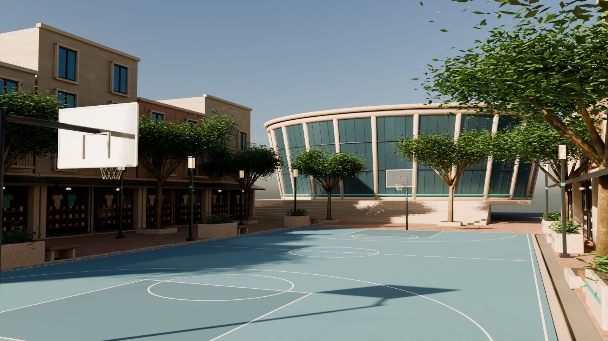
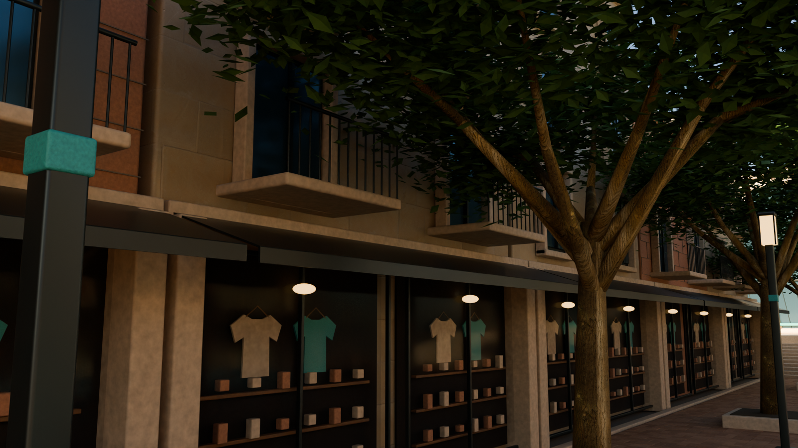

# Sundale street slice

An editable 3D scene modeled and rendered toward the first OddsWell visual concept, following the owner's request to continue on September 12, 2026. These are Blender Cycles renders of actual geometry. The reference image is not used as a background or projected onto the scene.

The scene contains a brick promenade, recessed storefront displays and awnings, stone/terracotta residential facades and balconies, mature tree canopies, planted limestone seats, a blue basketball court with two baskets and nets, and a glazed arena with a stepped approach. Teal bands connect the jacket, planters, lights, and arena. The clothing and exposed anatomy are a new static study; the game character and production map are unchanged.

## Editable source

Open `OddsWell_Sundale_StreetSlice.blend` in Blender 4.5 or later. Geometry is organized by asset family; six external texture maps are packed into the file. The gameplay camera is active, and two alternate cameras are retained. The main output is 1920x1080 at 160 Cycles samples with denoising; alternate views are 1600x900 at 96 samples. The shaded architecture close-up uses a brighter camera exposure for material inspection.

`build_scene.py` rebuilds the native scene, and `render_views.py` reopens the saved file, validates the collections and packed maps, and renders the alternate cameras. Run Blender in background mode with `--python-exit-code 1 --python build_scene.py`; add `-- --preview` for a smaller draft. Run `fetch_stone_material.py` with Python first only if the retained texture files are absent. The anatomical source is retained under `source-assets`.

## Sources

Architecture, paving, court, arena, plants, fixtures, garments, and scene composition were authored for this study. The exposed anatomical surfaces derive from the MakeHuman hm08 base mesh, released under [CC0 by MakeHuman](https://github.com/makehumancommunity/makehuman/blob/master/LICENSE.md); the original OBJ, asset license, source URL, and hash are retained. It is a static anatomical study, not a new approved gameplay rig or preset.

The sandstone and bark maps are [Sandstone Blocks 08](https://polyhaven.com/a/sandstone_blocks_08) and [Bark Brown 01](https://polyhaven.com/a/bark_brown_01), by Rob Tuytel, distributed under [Poly Haven's CC0 license](https://polyhaven.com/license). `textures/sources.json` records the original URLs and exact hashes. No paid marketplace asset or new paid generation was used for this scene.

## What this proves

The visual direction now has an editable modeled scene and multiple native renders, advancing beyond the earlier blockout and generated concept. It does not establish a finished Unreal scene, animation-ready character, collision, LODs, baked game materials, or a frame-rate target. The source is deliberately retained for continued modeling and eventual controlled engine integration. The reference remains the fidelity target; these renders do not claim an exact match or final art approval.
