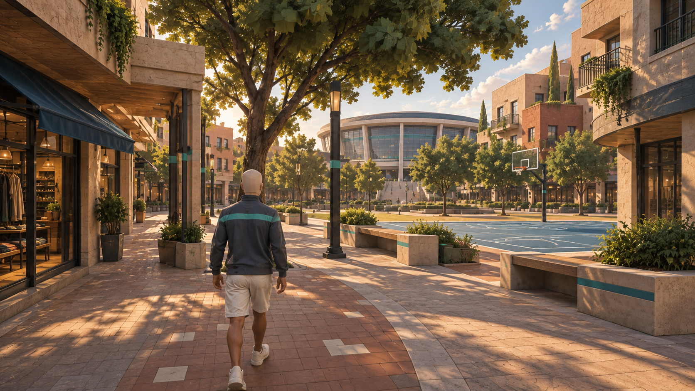
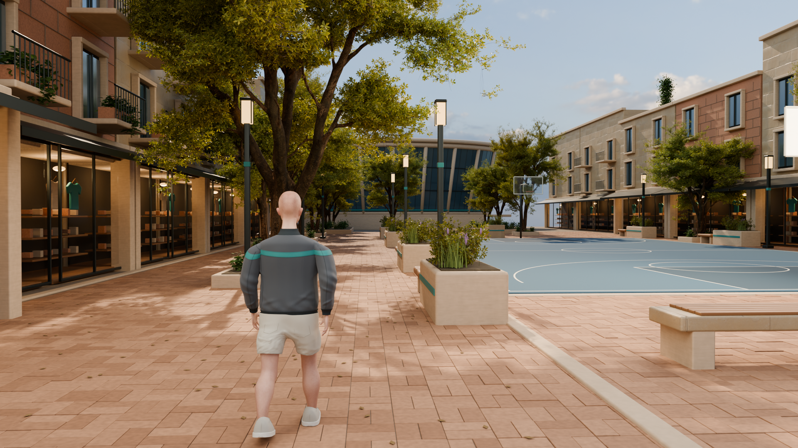
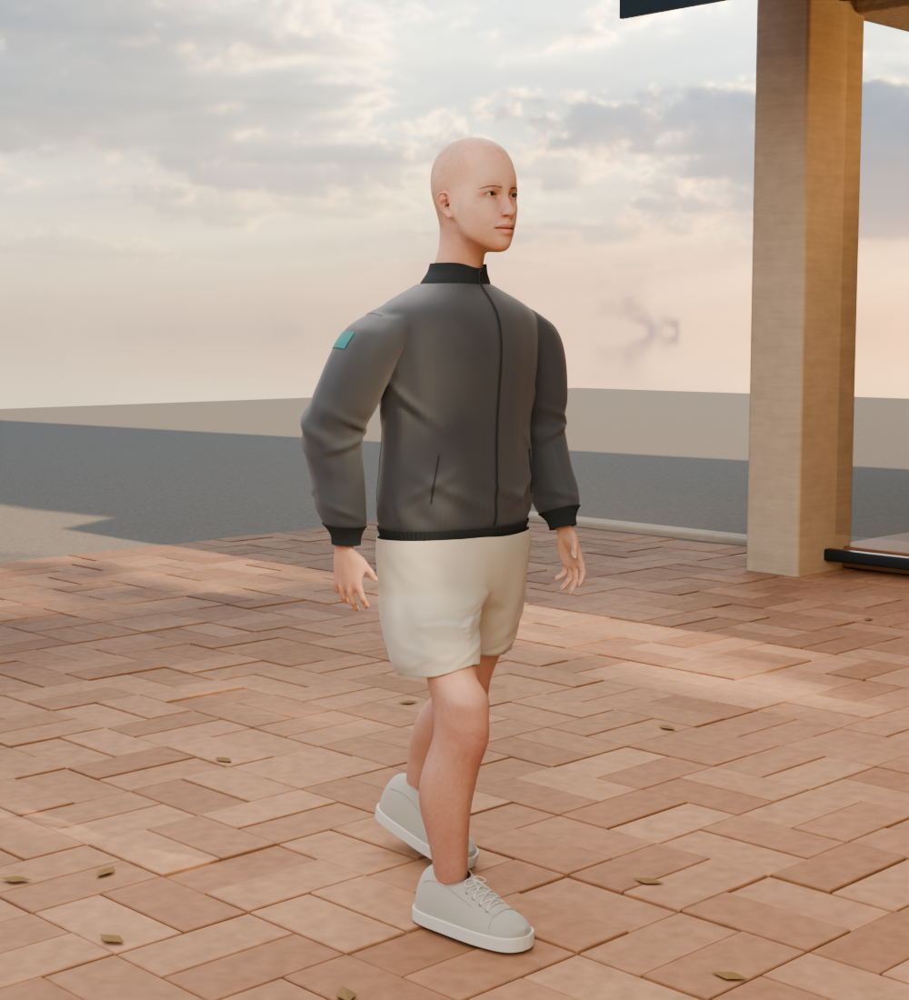
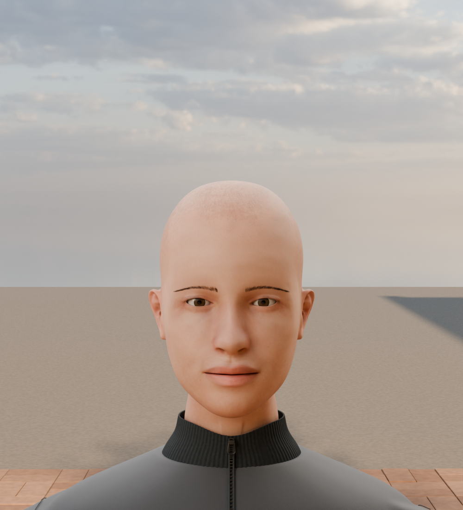
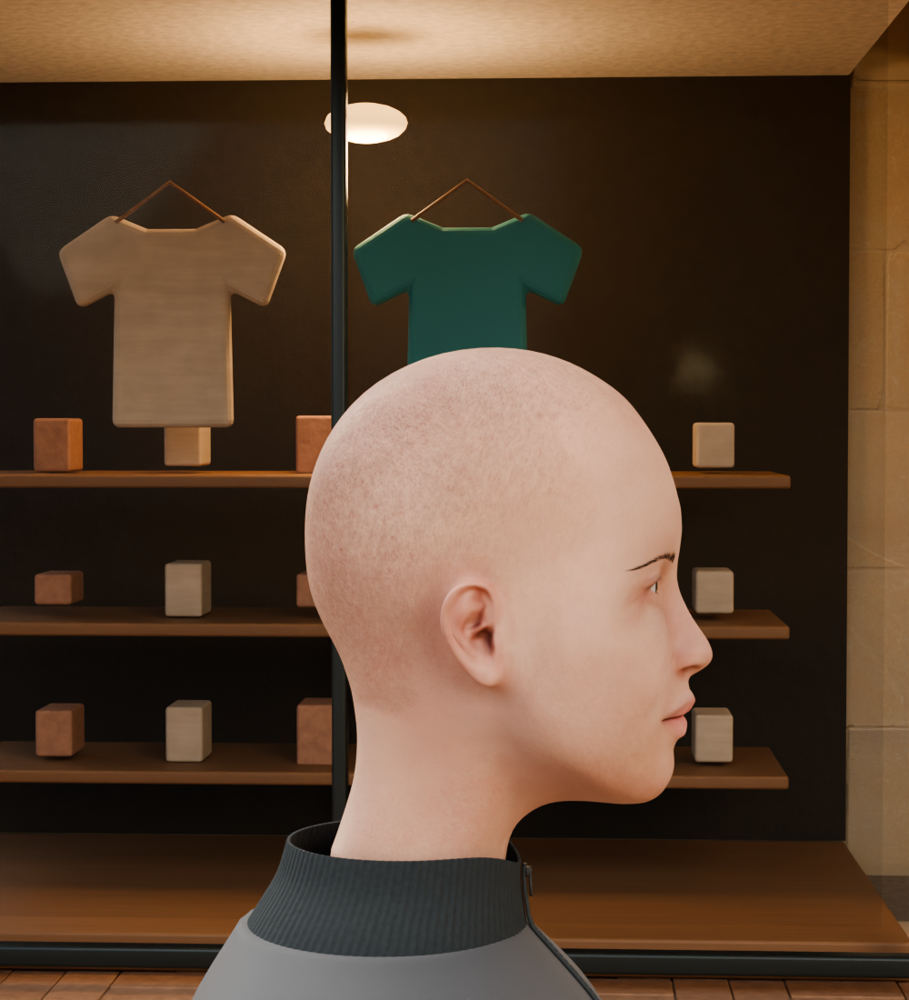

# Character and landscape development review

Continuing from `3b3caa0`, the forearms hang closer beneath the elbows and a shaped collar follows the neck, with a smaller continuous zipper and pull. Three pinned CC0 MakeHuman morph targets add restrained facial-age and eyelid changes in memory; the original anatomical OBJ remains unchanged. Native irises now carry radial color variation, finer brows follow a changing hair direction, and 96 tapered eyelashes are rooted at the actual visible lid margins. These details remain subtle and do not establish a lifelike facial expression.

The footwear now has recessed ankle openings with dark inner lining, a denser fitted tongue, crossed laces seated at paired eyelets, bow loops and free ends. The upper and sole profiles use smooth longitudinal interpolation; rounded sole edges surround a broad flat underside. Native close-ups exposed tongue intersections, displaced lace endpoints and an uneven upper/sole join. Those findings led to denser tongue faces, matching endpoint projections and a deeper upper overlap inside the extended sole.

The full realism goal remains active. The next major character work is shoulder/armhole construction and jacket drape, followed by hand tendon/nail detail, convincing eye tissue, skin response and expression. Review the complete figure against the original concept before proceeding to architectural/retail variety and planting realism. This checkpoint is an editable offline model, not an animation rig, gameplay cloth implementation or runtime update.

The first OddsWell picture remains the target, and the visual-quality goal remains **active**. The original starting point is `76ccb76`; preceding character/landscape checkpoints are `ae5144c` and `ab7ec49`.

Reference picture:

Current native gameplay render:

## Active human realism goal

The owner set a new sustained human-realism goal from `3af6bd9`. This first iteration articulates the hips, knees and ankles separately, with a flat forward stance foot and a raised trailing heel. A 40-frame native cotton simulation develops shorts drape; its result is blended with the tailored base and relaxed to avoid excessive tiny wrinkles. The simulation uses body proxies plus the actual leg surface, with a final skin-clearance correction and refitted seams.

Six original CC0 Poly Haven fabric maps now add photographed surface variation, displacement-derived bump and roughness to the jacket, shorts and canvas shoes. Terlenka provides the jacket weave; Denim Fabric 04 supplies the cotton weave, recolored in the shader to the existing OddsWell palette. Source photography is by colormass, processed by Rico Cilliers. The scene contains 31 packed maps. Box projection is an interim shading method; production garment UVs remain open.

Further native refinement reduces jacket torso/sleeve volume and concentrates folds around the armholes, elbows and waistband. Ribbed cuffs taper toward the wrists, with the sleeve ends fitted inside them. Each finger now bends around its three retained anatomical joints, with progressively deeper ring/little-finger curl and mild left/right asymmetry. The shoes have crossed laces, paired eyelets and a stitched toe panel. Fine tapered calf hairs follow the posed skin, and denser pocket-stitch samples follow the simulated shorts surface.

The first full-strength cloth studies produced excessive inseam wrinkles. Blending with the tailored shape and relaxing the smallest creases reduced that artifact. Native inspection then exposed the thigh through the draped hem. Clearance checks traced the defect to inward anatomical faces after the source Y/Z coordinate swap. Reversing face winding and matching UV corners preserves the original mapping while making skin contact outward. Actual-leg collision and post-smoothing clearance remove the visible thigh breakout. The saved-scene check measures the evaluated hem against the leg with a 1.5 mm tolerance; the exact measured minimum is retained in `cold-reopen.json`. This finite sampling is not a zero-intersection guarantee.

This is a realism development checkpoint, not completion of the new goal. The overall figure still reads as a digital model: shoulder/armhole shaping, garment tension and collar construction need more work, alongside hand tendon/nail detail, face/eyelid expression and skin response. The calf hair is deliberately subtle at gameplay distance. Cloth is retained as static editable geometry after simulation; no gameplay cloth, animation rig or runtime integration is claimed. Architecture/retail and planting remain next in the roadmap after the human passes the visual criteria.

Dedicated hand views exposed a loose cuff opening, followed by a protruding sleeve end after tapering. The sleeve profile now narrows inside the cuff; rib sampling was increased to resolve the fine channels. The pocket stitches also needed more samples to follow the curved garment instead of passing inside it between their corners.

The first full render review also caught an artificial crossing pattern in the lower back folds and a ledge where the shorts clearance correction snapped toward the cropped thigh boundary. Rear creases were shortened, softened and separated; clearance now moves cloth only along the skin normal, preserving its tangential position. The initial all-view render set was rejected for those visual defects despite passing the structural checks.

## Previous body refinement

The body continuation from `c19da50` adds a smaller, gently curled resting hand pose, more opposing arm swing with a soft elbow bend, and a narrower calf-to-ankle profile. The jacket has less abdominal bulk and localized front folds; shorts gain front compression creases. The sneakers have higher heel/instep profiles, fitted tongues, laces and quarter seams, a smoother rubber sole, and more length ahead of the ankle.

Dedicated hand and shoe close-ups caught an exposed opening near the thumb from the earlier coordinate-based source crop, plus upper laces intersecting the ankle. The hand extraction now follows the wrist/knuckle direction and retains the complete thumb. Shoe details are fitted to the evaluated upper and placed forward of the ankle. A second footwear review exposed inward upper normals that buried fitted laces; the upper normals are now outward and the laces sit outside the surface. The saved-artifact check rejects exposed hand boundary edges, inward shoe surfaces and detached or buried laces. These are editable static geometry changes, not a rigged animation or cloth simulation.

## Previous reference refinement

Continuing from human-face checkpoint `f46ac3b`, the upper jacket and arms are slimmer together, bringing the silhouette closer to the original reference. The slate fabric has less broad sheen, the jaw is subtly wider, and the shorts have localized diagonal gathers with a shallower rear-seat crease. Original anatomical UVs now carry a retained CC0 MakeHuman skin map across the head, hands and legs. Native close-ups show lip, cheek, ear and scalp variation; eye surface relief was reduced and reflections refined. The scene packs 25 maps and retains eight native review views.

The original procedural tint was still too uniform in the portraits. The source UV map adds surface variation without changing the original texture bytes. Full-figure and portrait review checked facial registration, neck/collar fit, cuffs and exposed limbs. Early jacket sheen was too broad and was reduced before delivery. These are static modeled creases and shaded skin; facial expression, eyelid refinement, individual identity and natural cloth drape remain open.

## Refinement after the first character checkpoint

The preceding owner request specifically asked for a more human character. From `c255dd5`, the authored oval head was replaced with the retained MakeHuman skull, face, ears and neck. Paired fitted eyes have separate curved irises and pupils; finer brow strands follow the evaluated face, with restrained cheek/lip tint and skin shading. The first native portraits exposed source shoulder fragments protruding through the collar. A planar neck crop and fitted skirt beneath the collar removed those fragments. A second brow draft was too coarse and high, so its strands were made finer and repositioned. Front and profile portraits are now part of the eight-view review set.

The result reads as human anatomy rather than a featureless mannequin, but remains a neutral static face study. Skin variation, the eyes, expression and individual character identity still need refinement before final approval. The front/profile images are native scene renders with the same outdoor lighting, not generated portraits.

On September 21, the owner resumed the saved broadleaf checkpoint. A first hip-fold preview produced narrow, stripe-like marks and was rejected. Checkpoint `8c868ec` retained broader, lower-amplitude shorts folds and a slightly stronger jacket-body fold.

The next pass replaces overlapping, voxel-unioned shorts volumes with a single surface sharing the hip circumference and curved inseam. The first transition produced a pronounced rear shelf; close-up review led to a gradual blend over the full leg height and reduced pre-pose offsets. Pocket seams were fitted to the evaluated cloth. The retained rear and three-quarter views show a smoother hip-to-leg transition and less bulky crotch. Sleeve caps are narrower and the upper shoulder join is locally relaxed. These are visible modeling improvements, but the cloth still reads as a static sculpt and the rear inseam needs further art direction.

Civic limestone now combines lower-contrast grain with broken horizontal sediment variation over its existing pores. The change is deliberately subtle. It is not a substitute for object-specific wear, edge treatment or more varied architecture.

The latest landscape pass replaces the fine compound foliage with adapted broad-leaf geometry and raises the woody branching before leaf emission. A single distribution pass over the combined branch masks reduces hanging, crowded patches. The court view reveals the far basket and more of the arena. Foreground shrubs now have woody stems and overlapping clusters from the same leaf family, with darker understory material settings. The retained Island Tree 01 source and seven leaf/twig maps are documented alongside the original Jacaranda source.

The jacket torso and posed sleeves now form one continuous surface. Smoothly interpolated tailoring profiles reduce angular shoulder and hip bands; the teal panels and seams are fitted to that surface. Hidden inner-sleeve panel vertices are removed before fitting so they cannot appear as teal slivers on the front shoulder. The cuff profile follows the sleeve, and compression folds fade into the knit bands.

The shorts have open, thickened hems and an open waist, with subdivision over the continuous tailored surface. The cold-open check counts the three boundary loops and rejects non-manifold edges. Earlier native close-ups exposed insufficient thigh coverage inside the hem; the retained anatomical surface extends farther under the shorts and fits within their opening. The exposed calves retain their volume. These changes address gaps and intersections, not only shading.

Thirteen mature trees use three shared growth variants with different leaf seeds, densities and crown proportions. The foreground hero stays fixed for composition; upright and spreading forms vary the street and forecourt. Stone and fired paving gain sparse pores and fine mineral relief, while oak fibers follow the seat slats and shelves. At gameplay distance these material changes are subtle; they do not replace the reference's richer wear and photographic detail.

## Changes visible in the native scene

- **Character:** clothing surfaces now include localized folds, matching seams, cuffs, a continuous pair of shorts, front zipper/welt pockets, heel details and a teal yoke extending onto the sleeves. Calves retain their volume, hands have a more relaxed shape, and the stance foot touches the promenade. The source-derived human head has a closed fitted neck, facial anatomy, paired eyes and fine brows.
- **Landscape:** shared mature tree geometry has more detailed branching and textured foliage, with adjusted growth density, proportions and color. The foreground tree moves behind the character; lower planting combines shrubs, grasses, flowers, groundcover, soil and fallen leaves. Planted stone seats and forecourt gardens connect the court to the arena.
- **Light and depth:** the arena moves farther back, shops have deeper lit interiors, and a photographed sky plus warm sunlight and reflected light replace the plain sky and flatter illumination. Tree shadows break up the promenade. Court paint remains flat against the play surface.

## Defects caught during review

Native previews and close-ups exposed sparse foliage, overly regular cloth folds, thin calves, floating feet, open shoe heels, a collar gap, separate shorts sections, floating roof planting, shoulder openings and distorted facial smoothing. These were corrected in the editable source and re-rendered. Raw modeling and render logs remain under the project’s ignored `client/OddsWell/Saved/NextTen20260912` work folder; the delivery manifest identifies the retained outputs. Working preview images are overwritten as the scene develops.

The tree comparison led to adapting CC0 native branching and leaf geometry instead of retaining the original radial-branch approximation. Source authorship is recorded in the README and retained manifests. Shrub stems and placement, grasses, garments, architecture and scene composition remain locally authored; shrub leaf geometry now shares the retained broad-leaf source.

## What remains below the reference

The reference has more natural garment drape, richer architectural variation and shop contents, subtler weathering, a more composed mixture of plants, and a more photographic finish. The current character is a static model and the scene is deliberately an offline art study. A successful render and geometric checks do not close those visual gaps.

The next visible priorities are eyelid and eye detail, expression, further finger articulation and a weight-bearing knee/hip pose, cloth behavior at the rear inseam and shoulder seam, varied facade/window arrangements, more convincing retail contents, and less uniformly clean foreground surfaces. Paving scale is established, but wear and small color changes still need refinement. Broad-leaf geometry is now present; crown composition, color balance and selective pruning still need art direction against the reference.

The higher trunks materially open the court view, but some low edge branches remain. Selective court-facing pruning and measured physical clearances are still required before treating this as production planting.

Next iterations should focus on those remaining visible differences before spending effort on engine import. LODs, collision, baked game materials, rigging and performance remain separate requirements. No runtime code, production map or tested package was changed by this art pass.
