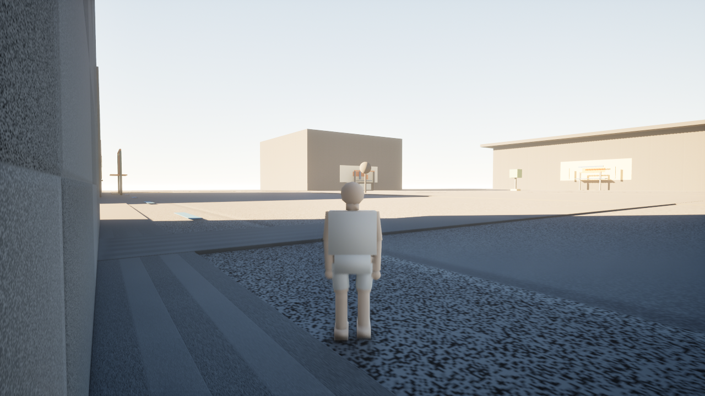
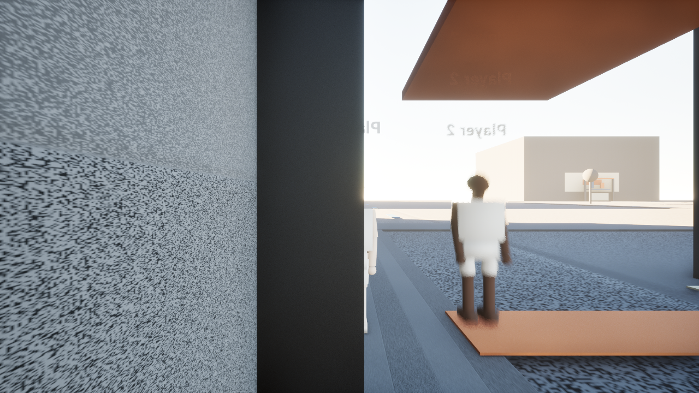
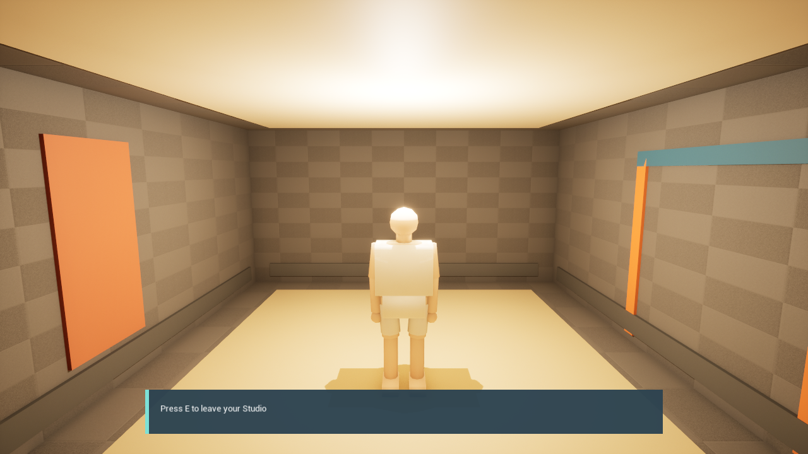
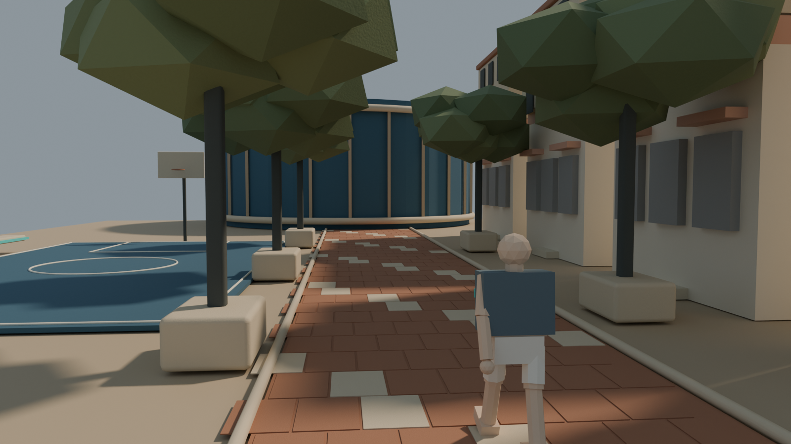

# OddsWell street identity review candidate

September 12, 2026. This review delivers step 9 of the next-ten-step batch. It proposes a visual direction; it does not approve final art or show a finished game.

## Proposed character and street

The proposed visual signature combines warm mineral stone, terracotta brick, deep blue public courts, mature green canopies, and a narrow teal band. The band connects the Signal Jacket to civic fixtures and the arena without requiring a logo. Human-scale shopfronts, a playable-looking court, and the arena in one ordinary street view communicate the relationship between everyday city life and basketball.

The image was generated with the built-in image tool using the accepted Sundale concept as a setting reference and the native Blender composition below as a scale/layout reference. It is concept art. Its refined clothing, shoes, back band, detailed architecture, trees, and realistic lighting are proposed additions, not implemented assets. The result is more realistic than the requested sculpted/painterly treatment; that treatment remains unresolved. The faceless character and warm civic setting follow the current direction, but neither recognizability nor final proportions receive approval from this review.

## Current packaged game

The actual Windows build now renders the shared skeletal character, follows movement with walk/run/jump/land clips, and keeps clothing on the same pose. The city is still a graybox. This is a comparison at the gameplay camera, not a matched-camera recreation of the generated composition. Exposure, material noise, character anatomy, garment silhouettes, foliage, and finished architecture still separate the build from the proposal.

The network capture shows the remote character with its different skin tone. Automated checks measure remote knee travel and replicated displacement. Camera obstruction, motion softness, and mirrored name labels make this a technical capture rather than an art-quality frame; visual cleanup remains open.

The Studio retains its empty starter layout and working leave prompt. Its existing teal/terracotta details offer a place to test the same visual rules in a home. Interior exposure and material finish remain unfinished.

## Native composition and next art decision

The editable Blender scene uses the current character derivative and residential facade. New procedural street/court/arena geometry is noncanonical study material. This study establishes scale and layout but is too plain to establish the requested identity. Its provenance and local build are recorded separately from the generated concept.

The next art milestone is one small production street slice with a refined character and jacket, tested in street, arena-adjacent, and Studio views with identifying text hidden. Resolve the amount of stylization and the recurring teal band before expanding the asset family. Owner review determines whether those ordinary screenshots feel distinctly OddsWell. The generated image does not demonstrate runtime performance or replace that review.

See [generation brief](generation-brief.md), [native provenance](provenance.json), and [batch evidence](../../../Development/Reports/NextTen20260912-evidence.json). Original generated output remains in the Codex image directory; this project copy is the durable review artifact.
